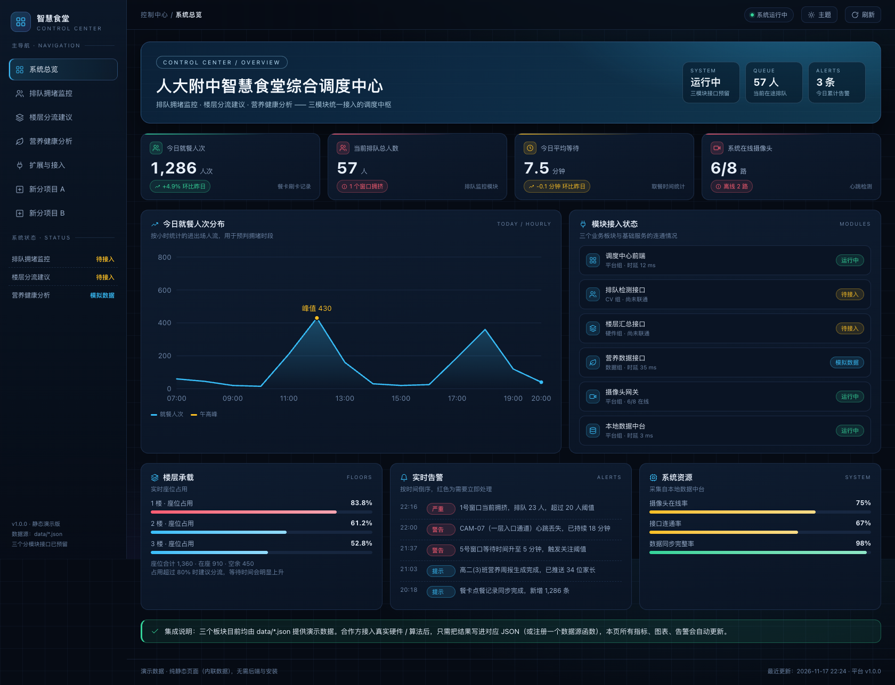

# 智慧食堂综合管理与健康分析系统

**课题：智膳 · 校园食堂多源数据协同调度系统**

> 让学生少排队、吃得准；让食堂少浪费、算得清。

| 项目信息 | 说明 |
| --- | --- |
| 项目名称 | 智慧食堂综合管理与健康分析系统 |
| 推荐课题 | 智膳 · 校园食堂多源数据协同调度系统 |
| 项目形态 | 校园总控大屏（Web）＋ 三个可插拔分模块 |
| 当前阶段 | 第一阶段：总控平台框架与可演示 demo（已完成） |
| 发起人 | 贺嘉懿（目前仅 1 人，正在公开招募同伴） |
| 代码仓库 | <https://github.com/hjyemss/shitang> |
| 文档版本 | v1.0 · 2026 年 11 月 |

---

## 一、我们要解决的是什么问题

中午 11:50 到 12:20，是学校一天里最拥挤的三十分钟。上千名学生从教学楼涌向食堂，而食堂有楼层、有窗口、有上百种菜品，但学生手里没有任何信息。

我们访谈时听到最多的三句话是：「不知道哪层人少」「排到一半才发现隔壁窗口空了」「这个菜 20 分钟就卖光了」。而对食堂来说，问题在另一侧：备多少菜靠经验，热门菜断供应激，冷门菜整盘倒掉，浪费和抱怨同时发生。

说白了，食堂有数据（饭卡、窗口、人流），但数据没有被「翻译」成任何一方能用的信息。我们这个项目要做的，就是把这三类数据接起来、算清楚、显示出来。

### 1.1 三个具体痛点

- **排队不透明**：站在一楼大厅，看不到二楼、三楼还有没有队；学生只能靠猜。
- **决策靠经验**：备餐量、窗口开放数量全凭师傅经验，缺数据支撑的日报。
- **营养无感**：学生一学期吃了什么、蛋白质够不够，没有任何反馈；家长更无从了解。

### 1.2 我们的答案：三条主线 + 一个底座

| 主线 | 把什么变成什么 | 对应模块 |
| --- | --- | --- |
| 感知（看得见） | 摄像头画面 → 各窗口排队人数、各楼层在座率 | 排队拥堵监控 |
| 调度（行得通） | 多区域人流 → 「现在去几楼吃最快」的建议 | 楼层分流建议 |
| 健康（吃得好） | 餐卡消费流水 → 六维营养画像 + 家长周报 | 营养健康分析 |
| 底座（撑得住） | 三模块数据 → 一屏可视化的总控平台 | 系统总览 / 扩展与接入 |

---

## 二、目标用户：谁会用、为什么用

一期只做「学生 + 食堂管理者」两端，因为这两端的需求最刚性、数据最容易拿到；家长端与学校管理层放到二期，避免一开始铺得太宽。

| 用户角色 | 核心诉求 | 我们提供什么 | 优先级 |
| --- | --- | --- | --- |
| 在校学生（主用户） | 少排队、少浪费时间；知道自己吃得健不健康 | 实时窗口热度、楼层分流建议、个人营养报告 | P0 |
| 食堂管理者 / 窗口员工 | 备餐更准、少浪费、知道哪个菜受欢迎 | 分时人流看板、菜品动销与备餐建议、拥挤预警 | P0 |
| 学校后勤 / 德育部门 | 秩序与安全、食品安全可追溯、数据可汇报 | 总控大屏、告警记录、按周汇总的运营报表 | P1 |
| 家长 | 了解孩子在校饮食是否均衡 | 周报推送（微信），只发营养结论，不发消费明细 | P1 |
| 项目开发者（合作方） | 低门槛参与、成果可展示 | 清晰的接口契约、可分头开发的三个模块 | P0 |

---

## 三、初步设想

### 3.1 产品形态：一个大屏，三个可插拔模块

总控大屏是「指挥中心」，负责把三个模块的数据汇到一屏；三个模块各自独立开发、各自往一个数据文件里写结果，谁也不用改别人的代码。这样即使某一块暂时没人做，平台也能完整演示——这正是目前版本的形态。

### 3.2 和学校盈利怎么共存（重要）

这是我们想得最久的一点：项目要让同学受益，但学校食堂也要算账。我们的原则是「**不靠提高单价，靠提高效率**」，让学生的体验和食堂的收益站在同一边：

- **错峰分流 → 提高翻台率**：同样一张桌子中午能多服务一轮，等于不扩建多出容量。
- **备餐预测 → 减少浪费**：按预测的人流和菜品动销备料，直接省钱，也减少断供。
- **健康推荐 → 带动高毛利健康菜**：不是涨价，而是把「本来会剩」的菜卖出去。
- **数据看板 → 让决策可复盘**：哪层该加窗口、哪个菜该下架，有数可依。

后续可以自然延伸的内容（暂不实现）：套餐预订与预约取餐、校园卡定向优惠、食堂档口的经营数据看板。这些都属于「学校可控的运营手段」，不会让学生多花钱。

### 3.3 边界与原则

- 只统计人数、不做人脸识别；摄像头数据本地处理，不存人脸、不外传。
- 营养数据按学生授权使用，家长周报只给结论与建议，不给消费流水。
- 演示阶段所有数字均为模拟数据，页面上明确标注「演示数据」。
- 不向学生收费、不做广告推送，盈利只体现在食堂运营效率上。

---

## 四、现在我们做到哪一步了

第一阶段已完成一个可以真正打开、真正能讲故事的「总控平台」：纯静态网页（HTML + JSON + JS），双击即可运行，不需要装 Python、不需要服务器、断网也能演示。它同时是我们后续接入三个分模块的「插座」。

| 已完成 | 内容 |
| --- | --- |
| 五个页面 | 系统总览 / 排队拥堵监控 / 楼层分流建议 / 营养健康分析 / 扩展与接入 |
| 两个预留槽位 | 「新分项目 A / B」由配置自动生成，演示「加一个板块只改一行 JSON」 |
| 数据层 | 每个板块一个 JSON 文件（相当于一张数据表），共 6 个 |
| 接入契约 | [`web/docs/INTERFACE.md`](web/docs/INTERFACE.md)：字段表 + 三种接入方式 + 常见坑 |
| 交付物 | 单文件版 [`dist/智慧食堂总控大屏.html`](dist/智慧食堂总控大屏.html)（可直接发给别人） |

技术栈：前端原生 HTML/CSS/JS（无框架、无 CDN）、图表为手写 SVG、数据为 JSON；演示数据由 Python 脚本从仿真库导出。三个分模块后续分别接 OpenCV + YOLO（排队）、多路摄像头汇总（楼层）、餐卡流水聚合（营养）。

---

## 五、本周五前可上线的「最小 demo」（设计稿）

目标不是做完整个系统，而是在周五前让至少 30 位同学真的用一次、并留下反馈。所以我们把范围压到极致：只做「学生打开手机就能看到的那一屏」。本节是设计稿，暂不实现。

### 5.1 形态：一个手机能打开的 H5 页面

把现在的总控大屏裁出一块「学生视角」：单个页面、上下滑动、无需登录，链接发到班级群，点开即用。数据全部标注为演示数据。

### 5.2 最小功能集（四项，缺一不可、多一不做）

| 功能 | 学生看到什么 | 数据从哪来 | 实现成本 |
| --- | --- | --- | --- |
| ① 窗口热度 | 六个窗口当前排队人数，红/黄/绿三色 | 演示数据 + 每天人工改一次 JSON | 低 |
| ② 去哪层吃 | 一句话建议：「现在去三楼，预计 2 分钟」 | 由①的楼层汇总算出 | 低 |
| ③ 今日营养卡 | 三道主推菜的热量与蛋白质，一句搭配建议 | 菜品营养表（人工录入 10 道菜） | 低 |
| ④ 一键反馈 | 底部三个问题，10 秒填完 | 页面内表单 → 收集到表格 | 低 |

### 5.3 用户路径（四步，30 秒内走完）

1. 在班级群点开链接 → 首屏直接看到「现在去哪层吃」，不需要任何操作。
2. 往下滑看到六个窗口的排队热度和预计等待时间。
3. 再往下是今日营养卡：热量、蛋白质、一句「建议加一份绿叶菜」。
4. 页面底部三个问题：会不会用？最想要哪个功能？一句话建议。

### 5.4 反馈怎么收、怎么算成功

| 指标 | 目标值 | 怎么测 |
| --- | --- | --- |
| 打开人数 | ≥ 30 人（1–2 个班） | 页面访问计数 / 二维码扫码数 |
| 反馈份数 | ≥ 15 份 | 表单提交数 |
| 有效的具体建议 | ≥ 5 条（不是「挺好」） | 人工阅读归类 |
| 关键结论 | 能回答「学生最想要哪个功能」 | 三题里的多选题统计 |

### 5.5 三天时间表

| 时间 | 要做什么 | 产出 |
| --- | --- | --- |
| 周三 | 从大屏裁学生端页面、录入 10 道菜与窗口数据、做反馈表单 | 手机能打开的页面 |
| 周四 | 找 3–5 位同学试用，改掉看不懂的文案和卡顿的地方 | 可用版本 v0.1 |
| 周五 | 发到 1–2 个班级群，收集反馈，当天汇总成一页结论 | 反馈报告 + 下一步优先级 |

### 5.6 红线（避免翻车）

- 页面必须显式标注「演示数据」，不能让学生误以为真实排队。
- 不做登录、不收手机号、不收集任何个人信息。
- 推送给家长的按钮只做展示，不真的发送。
- 如果当天数据没更新，宁可显示「数据未更新」，也不要编造。

---

## 六、招募：这个项目现在只有我一个人

第一阶段我一个人把平台骨架搭完了，也验证了「静态网页 + JSON」这条路走得通。但三个分模块（视觉、硬件、数据）不是一个人能同时推进的，所以在这里公开招募。你不需要什么都会——只要对其中一块有兴趣，愿意每周投入几个小时。

| 方向 | 希望你是 | 你会负责什么 | 每周投入 |
| --- | --- | --- | --- |
| 计算机视觉 / 算法 | 会 Python，了解 OpenCV，听说过 YOLO 更好 | 把摄像头画面跑成「每个窗口几个人」，输出 `queue.json` | 3–5 小时 |
| 前端 / 可视化 | 会 HTML/CSS/JS，或熟悉 Vue/React | 学生端 H5、把大屏做得更好看 | 3–5 小时 |
| 后端 / 数据 | 会 Python 或 Node，用过 SQLite/MySQL | 餐卡流水聚合、营养计算、接口与定时任务 | 3–5 小时 |
| 硬件 / 物联网 | 玩过行空板、树莓派、超声波或树莓派摄像头 | 窗口人数采集终端、离线也能跑的采集脚本 | 2–4 小时 |
| 产品 / 运营 / 设计 | 愿意做访谈、写文档、做问卷或海报 | 用户调研、反馈汇总、答辩材料 | 2–3 小时 |

**加入方式**：在 GitHub 仓库提一个 Issue（说明你想做哪一块、会什么），或直接找发起人聊十分钟。每周一次 30 分钟线上例会，同步进度、分任务。

**你能得到**：一个真正能在学校落地、能写进申请材料和答辩的真实项目；完整的「需求 → 开发 → 上线 → 收反馈」经历；以及一群一起把东西做出来的同伴。

---

## 七、代码仓库与协作方式

仓库地址：<https://github.com/hjyemss/shitang>

> 国内网络不开加速器时可能打不开 GitHub，建议先开加速器，或使用镜像代理访问；仓库里的 README 与 `docs/INTERFACE.md` 已经把「怎么接、接什么字段」写清楚了。

- **三种接入方式**：只交数据（写 JSON）、实时推送（`registerDataSource`）、新页面（`registerPage`）。
- **各写各的文件**：三个模块互不修改对方代码，平台只认数据文件。
- **字段不许自创**：以 [`web/docs/INTERFACE.md`](web/docs/INTERFACE.md) 为准，缺字段可以加，已有字段不要改名。
- **提交约定**：主分支保持可运行；每个人在自己的分支开发，合并前先自测页面能打开。

---

## 八、里程碑

| 时间 | 目标 | 交付物 |
| --- | --- | --- |
| 2026 年 11 月 | 总控平台框架完成（已完成） | 静态大屏 + 数据契约 + 单文件版 |
| 11 月下旬 | 学生端最小 demo 上线并收集反馈 | H5 页面 + 一页反馈结论 |
| 12 月 | 排队人数检测跑通（CV 组） | 摄像头 → `queue.json` 的自动更新 |
| 次年 1 月 | 楼层分流 + 营养分析接入 | 三层人流汇总、营养雷达与周报 |
| 次年 3 月 | 校内试运行与答辩 | 真实数据版本 + 答辩材料 |

---

## 九、备选课题名（供老师参考）

| 课题名 | 侧重点 |
| --- | --- |
| 智膳 · 校园食堂多源数据协同调度系统（推荐） | 强调「多源数据 + 调度」，覆盖三个模块 |
| 基于视觉感知与人流预测的校园食堂拥堵治理研究 | 偏算法与治理，适合计算机方向 |
| 面向学生营养均衡的校园餐饮数据服务平台 | 偏健康与数据服务，适合作品类课题 |

---

_版本 v1.0 · 2026 年 11 月 · 发起人：贺嘉懿_
